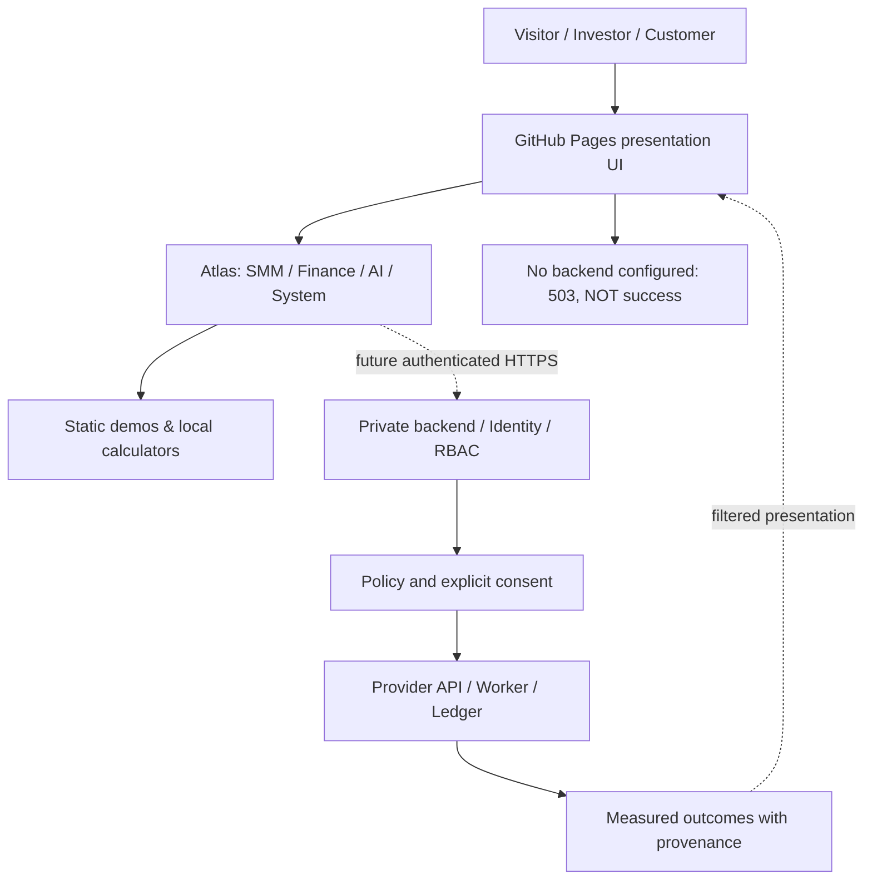

# SYNERGY AI ECOSYSTEM — публичный портал, продуктовый каталог и техническая карта

**Дата технической ревизии:** 24 октября 2026. **Статус:** действующие исходники статического веб-портала на GitHub Pages; **не** подтверждение работоспособности независимых финансовых, AI, SMM или blockchain сервисов.

**Публичные маршруты:** [Главная](https://shtenco.github.io/synergy.github.io/) · [Продуктовый Atlas](https://shtenco.github.io/synergy.github.io/portal/) · [Экосистема](https://shtenco.github.io/synergy.github.io/ecosystem/).

## Задача

Репозиторий соединяет в одной пользовательской навигации публичные веб-интерфейсы SYNERGY. Это **presentation and frontend integration layer**: путь человека от знакомства с экосистемой до выбора продукта и потенциального входа в авторизованный workflow. Публичная страница не становится банком, брокером, AI-инференс сервером, мессенджером или исполнительным API.

В дереве `main` обнаружены каталоги `portal`, `ecosystem`, `smm`, `cfo`, `investor-folio`, `riskguard`, `nexus`, `ai`, `market`, `avito`, `meta-api`, `workspace`, `advert` и другие frontend surfaces. Наличие HTML/JS страницы означает наличие UI/source, но **не** автоматически реального backend. Некоторые крупные SMM HTML-файлы являются историческими/монолитными интерфейсами — наличие сотен форм не подтверждает сотни работающих server methods.

## Что реализовано в source

| Компонент | Подтверждённый код | Граница |
|---|---|---|
| GitHub Pages | [`.github/workflows/pages.yml`](.github/workflows/pages.yml) | Job с `actions/configure-pages`, artifact upload и deploy-pages; факт последнего успешного запуска отдельно не проверен |
| Сайт / меню | [`index.html`](index.html), [`portal/atlas.js`](portal/atlas.js) | UI и клиентская маршрутизация |
| Продуктовый атлас | [`docs/ECOSYSTEM_ARCHITECTURE_RU.md`](docs/ECOSYSTEM_ARCHITECTURE_RU.md) | Архитектурный каталог 25 карточек в текущей документации, не 25 deploy-ready APIs |
| API safety fallback | [`assets/pages-runtime.js`](assets/pages-runtime.js) | Для same-origin API запросов без backend возвращает HTTP 503 и статус `backend_not_configured` |
| Статический аудит | [`scripts/audit_static_site.py`](scripts/audit_static_site.py) | Проверяет обязательные файлы, HTML href/src, часть секретных имён/расширений |
| Design contracts | [`scripts/check_design_contracts.py`](scripts/check_design_contracts.py) | Локальные DOM/navigation/css assertions для subset страниц |
| Архиватор | [`archiver.html`](archiver.html) | UI ≠ backend `/archiver` и не доказательство заявленных ratio/speed |
| SMM | [`smm/`](smm/) | Дизайн и frontend sources; разрешённые внешние отправки требуют backend/auth |
| Финансы | [`cfo/`](cfo/), [`investor-folio/`](investor-folio/), [`riskguard/`](riskguard/) | Client-side сценарии и презентации; не признание реальных денежных активов |
| META-API + Workspace | [`meta-api/`](meta-api/), [`workspace/`](workspace/) | Навигация на исследовательские server/desktop модули в других репозиториях |

## Архитектура: внешний интерфейс против authority



### Реальное поведение API fallback

В `assets/pages-runtime.js` устанавливается `window.SYNERGY_PAGES.staticHosting=true` и `backend=null`. Same-origin запросы, совпадающие с API prefix (`/api/`, `/auth/`, `/video/api/`, `/advert/api/`, `/market/api/`), не изображают успешное исполнение: без configured HTTPS origin перехватчик возвращает `503`. Остальные `fetch` проходят исходным маршрутом. Такой frontend guard **не является серверной системой безопасности**: нельзя полагаться на client JS как на единственный запрет действий.

## Экономическая постановка клиентского планировщика

Исторический слоган «Доходы − Расходы = Δ × Инвестиции = Капитал» — описание возможного цикла, а не бухгалтерское равенство и не гарантированная доходность. Для периода `t`:

$$
\Delta_t = Revenue^{confirmed}_t - Expense^{confirmed}_t.
$$

$$
Reserve_t=\max(0,\Delta_t)\,p_{reserve,t},
\quad
Contribution_t=\max(0,\Delta_t-Reserve_t)\,p_{invest,t}.
$$

Условная будущая стоимость при **моделируемой**, не гарантированной месячной доходности `r_m`:

$$
C_n=C_0(1+r_m)^n+\sum_{t=1}^{n}Contribution_t(1+r_m)^{n-t}.
$$

Правила: отрицательная дельта не создаёт инвестиционного взноса; учитывать обязательства, налоги, комиссии, просадки и инфляцию; UI не имеет права самостоятельно признавать платёж банковски подтверждённым. Скрипты Monte-Carlo измеряют свойства модельной симуляции, а не фактическую доходность бизнеса.

## Local reproducibility

```bash
git clone https://github.com/Shtenco/synergy.github.io.git
cd synergy.github.io
python scripts/audit_static_site.py .
python scripts/check_design_contracts.py
```

Для численного Monte Carlo regression предусмотрен workflow [`capital-montecarlo.yml`](.github/workflows/capital-montecarlo.yml). Он пытается вызвать `node tests/test_capital_montecarlo.cjs`. При ревизии дерева `main` этот test-файл **не был обнаружен** — поэтому существование workflow нельзя считать доказательством успешного CI. Это прямой предмет исправления перед присвоением GREEN.

Открытие сайта локально лучше проверять в Chromium с `http-server`/локальным web-server, а не только через `file://`, и отдельно проверять GitHub Pages base path `/synergy.github.io/`.

### Контракт визуальной регрессии

Для каждого публичного продукта требуется:
- безошибочный resolve внутренних относительных ссылок и assets;
- контраст, responsive layout (mobile/tablet/desktop), keyboard navigation, readable screen labels;
- empty/error/loading/success states должны соответствовать реальным server acknowledgements;
- отсутствие секретов, личных выгрузок, баз SQLite, .env и client-side API токенов;
- строгий запрет UI-success при 401/403/409/429/503;
- проверка сетевых запросов и CSP на настоящей published domain.

Статический аудитор выявляет часть ссылок и небезопасных расширений, но **не** выполняет comprehensive secret scanning/AST analysis и не подтверждает корректность браузерного исполнения.

## Federation map: что где живёт

| Domain owner | Репозиторий | Реальная граница |
|---|---|---|
| Архитектурный root | [SYNERGY SYSTEM](https://github.com/Shtenco/synergy_system) | Registry / contracts / evidence |
| Финансовые сценарии | [SYNERGY Financial OS](https://github.com/Shtenco/synergy_financial_os) | Не подменяется графиками портала |
| Риск | [SYNERGY RiskGuard](https://github.com/Shtenco/synergy_riskguard) | Risk policy gate отдельно от UI |
| META-API | [SYNERGY META-API](https://github.com/Shtenco/synergy_meta_api/tree/integration/meta-api-mcp-v0.1) | Limited local discovery and HTTP tool prototype, не production gateway |
| AI WORKSPACE | [SYNERGY AI WORKSPACE](https://github.com/Shtenco/synergy_ai_workspace/tree/feat/hybrid-google-oracle-v1) | Local SQLite control plane, desktop source, external actions blocked |
| Lead OS | [SYNERGY Lead Search Engline](https://github.com/Shtenco/synergy_lead_search_engline) | Offline candidate search, human verification |

## Статус развёртывания и исследовательские ограничения

Публичная GitHub Pages визуализация не равна полнофункциональной multi-tenant V9.7 платформе. В отдельной документации упоминается 529-файловый archive backend; его live installation, auth, MFA, queue workers и CI браузерного E2E здесь не подтвердились. Заявления о 144 методах SMM нельзя трактовать как 144 полноценные перенесённые интеграции. Browser-only auth state не обеспечивает серверную защиту пользовательских данных.

### Научно-инженерный критерий приемки

Только после CI с соответствующим SHA и реального browser testing можно повысить статус конкретной страницы. Для настоящего business KPI требуются внешние подтверждения `lead → permission → paid order → cash receipt → capital ledger`, а не клики и демонстрационные графики.

Следующий этап: закрыть найденные workflow blockers, прогнать 25 основных маршрутов, построить таблицу backend contracts и каждый статус привязать к факту исполнения.

---

## Исходный README (сохранён)

# SYNERGY AI ECOSYSTEM — GitHub Pages

Public site: https://shtenco.github.io/synergy.github.io/

V9.7 ecosystem navigation: https://shtenco.github.io/synergy.github.io/ecosystem/

The original SINERGYCHAIN landing page is preserved. The ecosystem route links to existing public frontend modules. It is not evidence that their backend functions are deployed.

## Architecture and deployment status

- Public static frontend: GitHub Pages workflow in `.github/workflows/pages.yml`.
- API: FastAPI/Uvicorn V9.7 source exists in the separately supplied 529-file archive; a production API deployment has **not** been confirmed.
- Identity: OIDC authorization code + PKCE and MFA enforcement are present in V9.7 source, but external IdP and shared session storage are not confirmed live.
- Browser E2E: Playwright CI included in archive, successful GitHub Actions run **not** confirmed.
- Legacy SMM: 144 schemas described; 0 independently accepted full end-to-end migrations. Unsafe/unverified execution must remain disabled.
- Database, workers, authorization and secret management require separately provisioned backend infrastructure. **Never put production secrets, credential files, or .env values in this public repository.**

## Release boundaries

The navigational portal published here does **not** constitute a full deployment of the V9.7 backend or full import of its 529-file source archive. Publish backend source and release artifacts only after secret scanning and a review of public/private IP and data exposure.

Copyright  2026 Evgeniy Koshtenko. All rights reserved.
