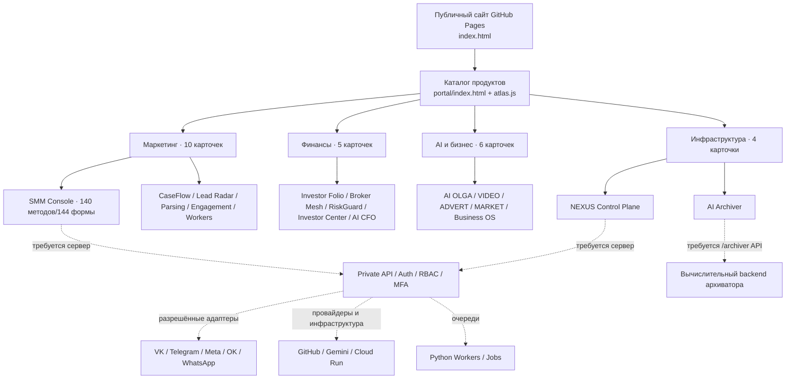
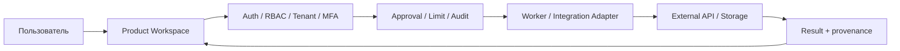

# Архитектура SYNERGY AI BLOCKCHAIN ECOSYSTEM — ИИ БЛОКЧЕЙН ЭКОСИСТЕМА СИНЕРГИЯ

> Источник: публичные исходники репозитория `Shtenco/synergy.github.io` — `portal/atlas.js`, `index.html`, `nexus/index.html`, `nexus/nexus.js`, `smm/cabinet.html`, `mvp.html`, `archiver.html`. Это **архитектура интерфейсов и предполагаемых интеграций**, не доказательство существования и работоспособности всех серверных компонентов.

## 1. Карта уровней

## 2. Каталог продуктов Atlas: 25 карточек

| Контур | Кол-во | ID в Atlas | Основные страницы |
|---|---:|---|---|
| SMM | 10 | 01,02,03,04,05,06,07,20,21,22 | `smm/`: AI Studio, Lead Radar, Parsing, Engagement, Jobs, Workspaces, Console, CaseFlow, CaseFlow Team, Audience Lab |
| Finance | 5 | 08–12 | `riskguard/`, `investor-folio/`, `broker-mesh/`, `investor/`, `cfo/` |
| AI/Business | 6 | 13–17, 23 | `ai/`, `video/`, `advert/`, `market/`, `mvp.html`, `avito/` |
| System | 4 | 18–19, 24–25 | `nexus/`, `archiver.html`, `meta-api/`, `workspace/` |

Числа и ID взяты из массива `services` в `portal/atlas.js`. В остальных директориях также есть вспомогательные страницы, не равные отдельным продуктам.

## 3. Правила и контракты

**Публичный интерфейс:** только презентации, навигация, формы, статические справочники и безопасные клиентские операции (например, скачивание самостоятельно составленного брифа). Этот слой **не хранит секреты** и **не гарантирует** выполнение приватных операций.

**API / Gateway:** должен проверять подписанную сессию, права пользователя, организацию, MFA там, где требуется; проводить серверную валидацию, лимитирование, журналирование, возврат ошибок и отказ при отсутствии подключения.

**Adapters:** GitHub / Gemini / GCP / Meta / VK / Telegram / другие площадки подключаются только после успешной проверки полномочий. Сохранённые в браузере значения не равны подключению.

**Python Workers:** очередь, задания и прогресс требуют отдельной серверной реализации. Не путать форму отправки задания и факт выполнения.

**Архиватор:** UI страницы работает на GitHub Pages, но endpoint `/archiver` должен размещаться на реальном вычислительном сервере. Для статического домена проверка здоровья API должна завершаться статусом «не подключён». Число движков, коэффициенты сжатия и контрольные суммы подтверждаются только реальными тестами.

## 4. Зависимости и границы безопасности

Все операции, влияющие на деньги, публикации, сообщения, доступы, аккаунты и данные других лиц, должны требовать действительной авторизации и соответствующих разрешений. Для таких операций недоступность API означает **запрет действия**, а не демонстрационный успех.

## 5. Очередность развития

1. Проверить каждую из 22 ссылок Atlas и провести Chromium E2E для desktop/tablet/mobile.
2. Устранить конфликты глобального CSS, исправить навигацию и адаптивность кабинет за кабинетом.
3. Подготовить недеструктивные HTTP contract tests каждого метода — без реальных рассылок, финансовых транзакций и публикаций.
4. Отдельно развернуть и защитить backend, IdP и секрет-хранилище, затем авторизованные интеграционные проверки.
5. Сопоставить интерфейсные статусы с фактическими проверками сервера и логами.

## 6. Состояние верификации

- В этой работе проверен исходный код публичных страниц и маршрутов.
- 22 карточки присутствуют в `portal/atlas.js`.
- Сохранённая логика `nexus.js` выполняет запросы к `/api/v1`, верификация реального удалённого API не подтверждена.
- Исходный `archiver.html` выполнял запросы к `/archiver`, но работоспособность сервера на Pages не подтверждена.
- Не утверждается, что все 22 продукта находятся на стадии production.

## Расширение 2026-10-22: единый финансово-операционный контур

Добавлены три самостоятельных продуктовых интерфейса: **AI AVITO** (`avito/`), **AI META-API-MCP** (`meta-api/`) и **AI WORKSPACE** (`workspace/`). Каталог расширен с 22 до **25** карточек. Источник AI AVITO — `synergy_ai_workspace/release/v1.0-desktop-rc/vendor/avito_ai_combine`, источник META-API — `synergy_meta_api/integration/meta-api-mcp-v0.1`, Workspace — `synergy_ai_workspace/release/v1.0-desktop-rc`.

### Цикл эффективности и будущего капитала

`Цель → AI WORKSPACE → META-API/MCP Policy + Discovery → выбранный адаптер (Avito / SMM / CRM / др.) → подтверждение действия → результат с происхождением → AI CFO (фактическая выручка, затраты, экономия, налоговые обязательства) → свободный денежный поток (после обязательств и резервов) → RiskGuard (лимиты, риск, проверка ликвидности) → Investor Folio (сценарии распределения) → согласование владельца → брокерский адаптер (не подключён) → аудит и обратная связь`.

Без подтверждённых платежей/банковских данных нет основания утверждать создание капитала. Не допускаются автоматические инвестиции, массовые сообщения и денежные операции без полномочий, проверки политик и разрешения владельца.

### Заимствование идей из 18 upstream-инструментов META-API

Учитываются gateway/registry/MCP/OpenAPI/workflow/LLM router/обсервабилити и consent-first integrations из приложенной исследовательской истории. В реальном `synergy_meta_api` рабочая интеграционная ветка содержит OpenAPI metadata bridge, каталог, deny-default policy, ограниченный REST/MCP, workflow и HTTP-разрешённые маршруты; **это не подтверждение полной дистилляции 18 независимых исходных кодовых баз**.

### Внутренние контракты, требующие реализации на сервере

- `GET /api/v1/capabilities` — только инструменты с подтверждёнными scopes.
- `POST /api/v1/workflows/plan` — расчёт плана без внешних действий.
- `POST /api/v1/workflows/{id}/approve` — проверка организации, MFA/роли, бюджета и явно утверждённых операций.
- `POST /api/v1/workflows/{id}/execute` — идемпотентный, аудируемый запуск разрешённых задач.
- `GET /api/v1/workflows/{id}/evidence` — результаты, затраты, квоты, ошибки и происхождение.
- `POST /api/v1/finance/reconcile` — сверка входных финансовых данных с источниками; производные цифры отдельно от подтверждённых.
- `POST /api/v1/finance/capital-allocation/plan` — только рекомендация; реальные инвестиционные распоряжения вне публичного frontend.

Эти пути — **проектные спецификации, а не работающие endpoints**.

## Формула единой бизнес-цели

**SYNERGY AI BLOCKCHAIN ECOSYSTEM / ИИ БЛОКЧЕЙН ЭКОСИСТЕМА СИНЕРГИЯ** объединяет автоматизацию, рост выручки, снижение операционных затрат, контроль резервов и долгосрочное инвестирование.

**Слоган:** Доходы − Расходы = Δ (Дельта) × Инвестиции = Капитал.

**Точная операционная расшифровка:**

- `Δ_t = Подтверждённые доходы_t − Подтверждённые расходы_t`. Дельта может быть отрицательной.
- `R_t = max(0, Δ_t) × доля_резерва_t` (размер отдельного резерва, вне инвестиционного портфеля).
- `I_t = max(0, Δ_t − R_t) × доля_инвестирования_t` — регулярный инвестиционный взнос только из положительной дельты.
- `C_n = C_0 × (1+r_m)^n + Σ_{t=1}^n I_t × (1+r_m)^{n−t}` — **модельный** капитал с реинвестированием, где `r_m` — предполагаемая месячная доходность. При отрицательной доходности капитал может снижаться.

`AI WORKSPACE/AI AVITO/SMM → AI CFO (сверка фактов) → резерв/обязательства → RiskGuard (лимиты) → Investor Folio (сценарии) → владелец (approval) → исполнение авторизованным брокером (пока не подтверждено)`.

Главная страница рассчитывает этот сценарий локально. Значения не отправляются на сервер; показанные суммы не заменяют налоги, комиссии, инфляцию, проверку ликвидности или финансовую консультацию.
