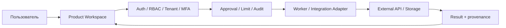

# Архитектура SYNERGY AI ECOSYSTEM — снимок 22.10.2026

> Источник: публичные исходники репозитория `Shtenco/synergy.github.io` — `portal/atlas.js`, `index.html`, `nexus/index.html`, `nexus/nexus.js`, `smm/cabinet.html`, `mvp.html`, `archiver.html`. Это **архитектура интерфейсов и предполагаемых интеграций**, не доказательство существования и работоспособности всех серверных компонентов.

## 1. Карта уровней

## 2. Каталог продуктов Atlas: 22 карточки

| Контур | Кол-во | ID в Atlas | Основные страницы |
|---|---:|---|---|
| SMM | 10 | 01,02,03,04,05,06,07,20,21,22 | `smm/`: AI Studio, Lead Radar, Parsing, Engagement, Jobs, Workspaces, Console, CaseFlow, CaseFlow Team, Audience Lab |
| Finance | 5 | 08–12 | `riskguard/`, `investor-folio/`, `broker-mesh/`, `investor/`, `cfo/` |
| AI/Business | 5 | 13–17 | `ai/`, `video/`, `advert/`, `market/`, `mvp.html` |
| System | 2 | 18–19 | `nexus/`, `archiver.html` |

Числа и ID взяты из массива `services` в `portal/atlas.js`. В остальных директориях также есть вспомогательные страницы, не равные отдельным продуктам.

## 3. Правила и контракты

**Публичный интерфейс:** только презентации, навигация, формы, статические справочники и безопасные клиентские операции (например, скачивание самостоятельно составленного брифа). Этот слой **не хранит секреты** и **не гарантирует** выполнение приватных операций.

**API / Gateway:** должен проверять подписанную сессию, права пользователя, организацию, MFA там, где требуется; проводить серверную валидацию, лимитирование, журналирование, возврат ошибок и отказ при отсутствии подключения.

**Adapters:** GitHub / Gemini / GCP / Meta / VK / Telegram / другие площадки подключаются только после успешной проверки полномочий. Сохранённые в браузере значения не равны подключению.

**Python Workers:** очередь, задания и прогресс требуют отдельной серверной реализации. Не путать форму отправки задания и факт выполнения.

**Архиватор:** UI страницы работает на GitHub Pages, но endpoint `/archiver` должен размещаться на реальном вычислительном сервере. Для статического домена проверка здоровья API должна завершаться статусом «не подключён». Число движков, коэффициенты сжатия и контрольные суммы подтверждаются только реальными тестами.

## 4. Зависимости и границы безопасности

Все операции, влияющие на деньги, публикации, сообщения, доступы, аккаунты и данные других лиц, должны требовать действительной авторизации и соответствующих разрешений. Для таких операций недоступность API означает **запрет действия**, а не демонстрационный успех.

## 5. Очередность развития

1. Проверить каждую из 22 ссылок Atlas и провести Chromium E2E для desktop/tablet/mobile.
2. Устранить конфликты глобального CSS, исправить навигацию и адаптивность кабинет за кабинетом.
3. Подготовить недеструктивные HTTP contract tests каждого метода — без реальных рассылок, финансовых транзакций и публикаций.
4. Отдельно развернуть и защитить backend, IdP и секрет-хранилище, затем авторизованные интеграционные проверки.
5. Сопоставить интерфейсные статусы с фактическими проверками сервера и логами.

## 6. Состояние верификации

- В этой работе проверен исходный код публичных страниц и маршрутов.
- 22 карточки присутствуют в `portal/atlas.js`.
- Сохранённая логика `nexus.js` выполняет запросы к `/api/v1`, верификация реального удалённого API не подтверждена.
- Исходный `archiver.html` выполнял запросы к `/archiver`, но работоспособность сервера на Pages не подтверждена.
- Не утверждается, что все 22 продукта находятся на стадии production.
